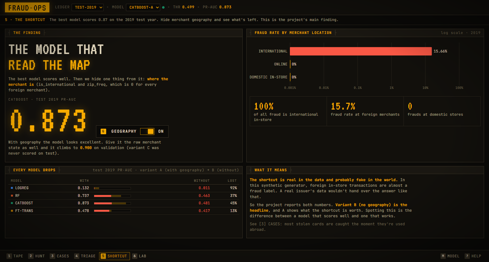

# Credit Card Fraud Detection: IBM Synthetic Transactions

[](https://github.com/KarenEmad-1/ibm-credit-card-fraud-detection/actions/workflows/ci.yml)

End-to-end fraud detection on **24.4 million** credit card transactions (IBM's synthetic dataset, 2,000 users, 1991–2020). The work starts with a careful EDA and a leakage-checked feature pipeline before any model is trained.

> **Status:** complete. All four models were scored once on the 2019 test year (see [Results](#results-2019-test-year)).

## Key findings

| Finding | What it means for modeling |
|---|---|
| Fraud is **0.122%** of transactions (1 in 818) | Accuracy is useless. Evaluate with PR-AUC and recall at a fixed precision |
| Online is **11% of volume but ~62% of fraud** | Payment channel is a strong feature |
| Foreign merchant states show **50–100% fraud** vs ~0.03% domestic | Probably a synthetic-data shortcut. Measured with an ablation, not trusted blindly |
| **2020 has 0 frauds** in 336k transactions (~400 expected) | Labels look missing, so 2020 is excluded from evaluation |
| A first purchase at a new merchant is **12.8× more likely** to be fraud | Per-card history features carry real signal |
| Missing merchant state/zip is structural (online transactions) | Encoded explicitly, not imputed |
| Four selection methods agree on dropping 6 of 36 features, with no loss in validation PR-AUC | Every model uses the same 30 selected features |
| Tuned CatBoost has a validation PR-AUC of 0.900 with `merchant_state`, 0.864 without it and 0.480 with the direct geography features removed | The geographic shortcut is large, so results are reported with and without it |
| User snapshot features (age, income, FICO…) add nothing | Excluded: leakage risk with no benefit |

## Approach

- **Chronological split:** train 1991–2017 · validation 2018 (2,491 frauds) · test 2019 (2,087 frauds). A random split would let the model learn from the future.
- **Per-card history features** use only *past* transactions: activity in the last 1h/24h, recent errors, time since the last transaction, new-merchant flag, and amount vs the card's own history.
- **Leakage is tested, not assumed:** the history features are identical whether or not future data is present (truncation test), windowed counts match a brute-force recount, and encoders are fitted on the training period only. These checks run as tests: `pytest tests/`.
- **No label-derived features.** In production, fraud labels arrive weeks late.

## Roadmap

1. ~~EDA~~ ([`01_eda.ipynb`](notebooks/01_eda.ipynb))
2. ~~Checked table joins, chronological split and feature engineering~~ ([`02_features_split.ipynb`](notebooks/02_features_split.ipynb))
3. ~~Feature selection with four techniques: correlation + mutual information, L1 logistic regression, CatBoost importance, permutation importance~~ ([`03_feature_selection.ipynb`](notebooks/03_feature_selection.ipynb))
4. ~~Traditional models: logistic regression and Random Forest, tuned with Optuna~~ ([`04_traditional_models.ipynb`](notebooks/04_traditional_models.ipynb))
5. ~~CatBoost, then tuning~~ ([`05_catboost.ipynb`](notebooks/05_catboost.ipynb))
6. ~~FT-Transformer (deep learning for tabular data), then tuning~~ ([`06_ft_transformer.ipynb`](notebooks/06_ft_transformer.ipynb))
7. ~~Ablations: geographic shortcut, user-snapshot leakage, per-segment performance~~ ([`07_ablations.ipynb`](notebooks/07_ablations.ipynb))
8. ~~Final evaluation of all models on the 2019 test year (once), with bootstrap confidence intervals and SHAP~~ ([`08_final_evaluation.ipynb`](notebooks/08_final_evaluation.ipynb))

Every model uses the same split, the same metrics (PR-AUC, recall at fixed precision) and a decision threshold chosen on validation. The original reasoning behind the phases is in section 8 of the EDA notebook.

## Results: 2019 test year

The test year (1.72M transactions, 2,087 frauds) was scored **once**, after every model, feature set and threshold was frozen on validation. **B** is the headline variant: geography removed (`is_international`, `zip_freq`). **A** keeps it.

| Model | Val PR-AUC (B) | **Test PR-AUC (B)** | 95% bootstrap CI | Test PR-AUC (A) |
|---|---|---|---|---|
| CatBoost | 0.480 | **0.481** | 0.454–0.504 | 0.873 |
| Random Forest | 0.483 | **0.463** | 0.443–0.485 | 0.737 |
| FT-Transformer | 0.424 | **0.417** | 0.392–0.441 | 0.478 |
| Logistic regression | 0.020 | **0.011** | 0.010–0.013 | 0.132 |

- **Validation scores held on test.** Every B model is within 0.02 of its validation score, so model selection did not overfit validation.
- **CatBoost and Random Forest are statistically tied** on B: CatBoost leads by 0.018, with a paired bootstrap CI of −0.012 to +0.044. Both beat FT-Transformer significantly. Gradient-boosted and bagged trees beat the deep tabular model here.
- **Logistic regression B (0.011) is weak but not broken.** The fraud base rate is 0.0012, so a random ranking scores about 0.001 and LR B is roughly 9× chance. With geography removed, the remaining signal lives in interactions (channel × new merchant × amount vs the card's history), which a linear model can't represent without hand-built cross terms. That is why the tree models gain so much over it.
- **The geographic shortcut is worth 0.39 PR-AUC** (CatBoost A − B, CI 0.378–0.410), which confirms the ablation finding on unseen data.

**Limitations**
- **All 2,087 test frauds are in-store international transactions**, none domestic or online (in validation, 94% were). The models are therefore tested on one fraud pattern. Within that segment, CatBoost B reaches 0.877 PR-AUC.
- **Geography may still leak into B through `merchant_city_freq`.** It is the top SHAP feature for Random Forest B (0.39 of mean |SHAP|) and for CatBoost B and FT-Transformer B. Rare foreign cities may stand in for "international", as `zip_freq` did. The test year is spent, so this is reported here and not tested with another ablation.
- The data is synthetic (see [Data](#data)).

Figures: [`test_pr_curves.png`](reports/figures/test_pr_curves.png), [`shap_share_heatmap.png`](reports/figures/shap_share_heatmap.png), [`shap_beeswarms.png`](reports/figures/shap_beeswarms.png). Tables: `reports/test_*.csv`, `reports/shap_importance_share.csv`.

## Dashboard: FRAUD-OPS



A fraud operations console in the style of a trading terminal. FastAPI serves the data, and the frontend is Preact + htm + D3 loaded as ES modules, so there is no build step. It serves only scores the notebooks already saved and never re-scores a split, so the 2019 test year stays sealed until notebook 08 has scored it once.

```bash
python scripts/build_dashboard_data.py --split val    # validation year 2018
python scripts/build_dashboard_data.py --split test   # test year 2019, from notebook 08's saved scores
uvicorn api.main:app --port 8000                      # open http://localhost:8000
```

| Key | Screen | What it does |
|---|---|---|
| 1 | TAPE | Replays the year live (server-sent events): a transaction tape, an alert queue whose labels arrive after a delay, alerts per hour, and feature drift (PSI vs training) |
| 2 | HUNT | Beat the model: judge 10 transactions as fraud or legit, with the card's recent history, then see all four models' verdicts and the SHAP reasons |
| 3 | CASES | Card attack files: a timeline of one stolen card with risk score, time to detection and dollars lost before the first catch, plus SHAP for any point |
| 4 | TRIAGE | One shift with a limited investigation budget: pick alerts, then compare your dollars recovered with ranking by score, by score × amount, and with hindsight |
| 5 | SHORTCUT | Switches geography off and shows test PR-AUC fall from 0.873 to 0.481 (validation: 0.864 to 0.480): the project's main finding |
| 6 | LAB | PR curves, model board, threshold simulator and per-segment metrics |

`M` cycles the model, `T` switches between amber and green phosphor, and `?` opens help. API docs are at `/docs`.

## Run it with Docker

No Python, no Kaggle download and no training needed. Either command serves the full 2019 test year on http://localhost:8000:

```bash
docker run --rm -p 8000:8000 ghcr.io/karenemad-1/ibm-credit-card-fraud-detection:latest   # published by CI
docker compose up --build                                                                 # built from this repo
```

The container holds about 1 GiB in memory. The data and models come from a [GitHub Release](https://github.com/KarenEmad-1/ibm-credit-card-fraud-detection/releases/tag/demo-data-v1) of derived files only, never the raw CSV.

| Design choice | Why |
|---|---|
| Multi-stage build: frontend, dependencies, tests, data bundle, runtime | Build tools and test packages stay out of the final image |
| Base images pinned by digest, Python packages by hash, the data bundle by SHA-256 | A rebuild uses the same inputs, and a changed download fails the build |
| Preact, D3 and fonts copied into the image | The page works with no CDN at runtime |
| Unprivileged user, and a read-only filesystem under Compose | The app only reads, so it cannot modify its own code or data |
| `/health` answers only once the data is loaded | The host sends no traffic to an app that is still starting |

## CI and deployment

[`ci.yml`](.github/workflows/ci.yml) runs on every push:

1. **Lint** with Ruff.
2. **Test:** pytest runs inside the image's own `test` stage, with the same OS, Python and locked packages as production.
3. **Image:** builds the full image and runs [`smoke_test.py`](scripts/smoke_test.py) against it. The test checks the headline PR-AUC (0.4808), the alert count, that SHAP contributions add up to the saved score, and that the live replay streams. On `main`, the image is then published to GHCR.
4. **Sample:** builds the image that [`render.yaml`](render.yaml) describes and smoke-tests it under a hard 512 MB limit with no swap.

**Sample mode.** The full test year does not fit in the 512 MB of a free host, so `render.yaml` uses a January 2019 bundle (146,097 transactions, 203 frauds). The headline metrics and PR curves there are still the full-year ones. Everything computed live, such as the threshold simulator and triage, uses the sample, and the dashboard shows a SAMPLE DATA banner.

## Project structure

```
├── data/
│   ├── raw/                  # Kaggle CSVs (not committed, see data/README.md)
│   └── cache/                # generated Parquet files and saved scores (not committed)
├── notebooks/
│   ├── 01_eda.ipynb
│   ├── 02_features_split.ipynb
│   ├── 03_feature_selection.ipynb
│   ├── 04_traditional_models.ipynb   # logistic regression, Random Forest
│   ├── 05_catboost.ipynb
│   ├── 06_ft_transformer.ipynb
│   ├── 07_ablations.ipynb            # geography, user snapshots, segments
│   └── 08_final_evaluation.ipynb     # single test-year scoring, bootstrap CIs, SHAP
├── src/
│   ├── data.py               # loading, cleaning, Parquet caching, checked user/card joins
│   ├── features.py           # split definition, leakage-safe feature engineering, encoders
│   ├── modeling.py           # sampling, preprocessing, shared model helpers
│   ├── evaluation.py         # one metric protocol for every model (PR-AUC, recall@precision)
│   ├── ft_transformer.py     # FT-Transformer written directly in PyTorch
│   └── final_models.py       # frozen training recipes reused by notebooks 07-08
├── reports/
│   ├── figures/              # PR curves, SHAP plots, EDA figures
│   ├── best_params_*.json    # tuned hyperparameters
│   ├── optuna_trials_*.csv   # full tuning histories
│   ├── val_metrics_*.csv     # validation results per model and ablation
│   └── test_*.csv            # test-year metrics, bootstrap CIs, paired differences
├── api/
│   ├── main.py               # FastAPI app, serves the dashboard
│   ├── store.py              # in-memory saved scores, loaded once at startup
│   └── routers/              # performance, replay (SSE), play (game/triage), transactions
├── dashboard/                # Preact + htm + D3 frontend, no build step
├── scripts/
│   ├── build_dashboard_data.py   # gathers saved scores into the dashboard's data
│   ├── package_demo_assets.py    # packs the demo data and models for a GitHub Release
│   └── smoke_test.py             # checks a running server, used by CI
├── tests/
│   └── test_leakage.py       # truncation, brute-force recount and encoder leakage tests
├── .github/workflows/ci.yml  # lint, test, build, smoke test, publish
├── deploy/nginx.conf         # optional proxy for testing the live replay
├── Dockerfile
├── docker-compose.yml
├── render.yaml               # Render blueprint: the free 512 MB demo
├── environment.yml
├── requirements.txt          # full project (notebooks)
├── requirements-serve.lock   # hashed packages for the image
└── LICENSE
```

## Setup

```bash
conda env create -f environment.yml
conda activate fraud-detection
python -m ipykernel install --user --name fraud-detection
```

Run the leakage tests with `pytest tests/`. They use synthetic data and take a few seconds, plus one check on the real data that runs once the cache exists.

Download the data as described in [`data/README.md`](data/README.md), then run the notebooks in order. The first load parses the 2.3 GB CSV (about 2 minutes) and caches it as Parquet. Later loads take seconds.

## Data

[Credit Card Transactions](https://www.kaggle.com/datasets/ealtman2019/credit-card-transactions) by Erik Altman (IBM), on Kaggle. The data is **synthetic**: patterns reflect the generator, so results won't transfer directly to real fraud.
